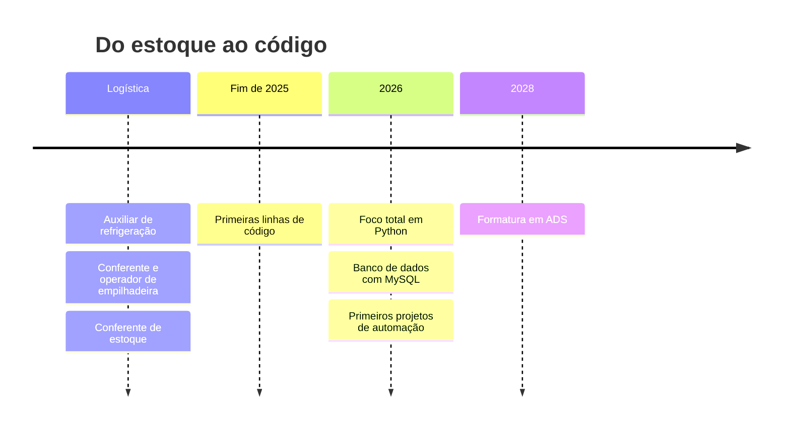
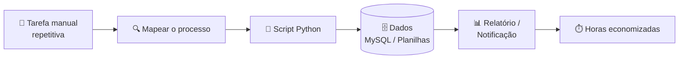

<div align="center">

# 🧪 Laboratório de Automações

<a href="https://github.com/Cavalcantiof">
  
</a>

<p>
  
  
  
  
</p>

</div>

```diff
@@ boot do laboratório @@
+ [ OK ] Carregando background: logística & estoque
+ [ OK ] Importando módulos: python, mysql, git
+ [ OK ] Conectando ao banco de ideias...
- [WARN] Tarefa manual repetitiva detectada → agendando automação
+ [ OK ] Laboratório pronto. Seja bem-vindo(a)!
```

### 🔬 Ficha de Inicialização // Developer Profile

```yaml
nome: Samuel Cavalcanti
local: Olinda - PE, Brasil
build: Estudante de Análise e Desenvolvimento de Sistemas (ADS)
modulo_atual: Engenharia de Automações & Otimização de Processos
background: Logística e estoque (conferente / operador de empilhadeira)
diretriz_principal: "Se um humano precisa fazer a mesma coisa 3 vezes, um script deveria fazer pra sempre."
```

> 💡 Vim do chão do estoque: conferência, contagem, planilha, retrabalho.
> Hoje eu uso código para eliminar exatamente esse tipo de tarefa manual.

---

### 🤖 Este README é uma automação

> Esta seção **não é escrita por mim**: um script Python roda sozinho todo dia via GitHub Actions,
> consulta a API do GitHub e reescreve este bloco. [Ver o código ↗](./scripts/atualizar_readme.py)

<!--LAB:START-->
```text
🧪 DIÁRIO DO LABORATÓRIO
├── 🕒 última execução do robô: 24/10/2026 às 06:14 (Recife)
├── 🐍 dias estudando Python: 115
├── 📦 projetos públicos: 1
├── 🔧 mexi recentemente em:
│   └── organizador-downloads (Python) · 2026-10-22
└── 💬 frase do dia: "Primeiro faz funcionar, depois faz bonito, depois faz sozinho."
```
<!--LAB:END-->

---

### 🛣️ Jornada



---

### ⚙️ Como eu penso uma automação



---

### 📋 Nota de Conferência — Skills

<div align="center">

</div>
<br/>

| Cód. | Item | Esperado | Conferido | Status |
|:---:|---|:---:|:---:|---|
| 001 | Python (lógica, funções, POO) | ✔ | ✔ | 🟢 OK |
| 002 | MySQL | ✔ | ✔ | 🟢 OK |
| 003 | Git & GitHub | ✔ | ✔ | 🟢 OK |
| 004 | GitHub Actions | ✔ | ✔ | 🟢 OK — este README prova |
| 005 | Planilhas (pandas / openpyxl) | ✔ | ⏳ | 🟡 Em conferência |
| 006 | Bots & web scraping (Selenium) | ✔ | ⏳ | 🟡 Em conferência |
| 007 | Arduino | ✔ | ⏳ | 🟡 Em conferência |
| 008 | APIs com FastAPI | ✔ | — | 🔴 Pendente |

<sub>📦 Conferente: Samuel · Divergências serão corrigidas no próximo commit.</sub>

---

### 🚀 Projetos em destaque

<details open>
<summary><b>🗂️ Organizador de Downloads</b> — Python</summary>
<br/>

Script que organiza automaticamente a pasta Downloads, movendo cada arquivo para uma subpasta de acordo com o tipo (Imagens, Documentos, Vídeos, Músicas...).

- ✅ Classifica arquivos pela extensão
- ✅ Nunca sobrescreve: nomes repetidos viram `arquivo (1).ext`
- ✅ Ignora downloads em andamento (`.crdownload`, `.part`)
- ✅ Pode rodar várias vezes sem bagunçar o que já foi organizado
- ✅ No Windows, roda com dois cliques no `organizador.bat`

🔗 [Ver repositório](https://github.com/Cavalcantiof/organizador-downloads)
</details>

<details>
<summary><b>🤖 README Automático</b> — Python + GitHub Actions</summary>
<br/>

O próprio perfil que você está lendo: um robô diário que consulta a API do GitHub e atualiza o diário do laboratório sozinho.

🔗 [Ver o script](./scripts/atualizar_readme.py) · [Ver o workflow](./.github/workflows/laboratorio.yml)
</details>

---

### 📡 Telemetria

<div align="center">


</div>

---

### 🛠️ Tem uma tarefa repetitiva?

<div align="center">

Me conta qual processo manual te tira do sério. Talvez ele vire meu próximo projeto.

<a href="https://github.com/Cavalcantiof/Cavalcantiof/issues/new?title=%F0%9F%A4%96+Pedido+de+automa%C3%A7%C3%A3o%3A+&body=**Qual+tarefa+%C3%A9+repetitiva%3F**%0A%0A**Com+que+frequ%C3%AAncia+ela+acontece%3F**%0A%0A**Quais+ferramentas+est%C3%A3o+envolvidas%3F+(planilha%2C+site%2C+sistema...)**%0A">
  
</a>

</div>

---

### 📬 Canal de comunicação

<div align="center">

<a href="https://www.linkedin.com/in/samuelcavalcantiof"></a>
<a href="mailto:samuelcavalcantida@gmail.com"></a>

<br/><br/>

<picture>
  <source media="(prefers-color-scheme: dark)" srcset="https://raw.githubusercontent.com/Cavalcantiof/Cavalcantiof/output/github-snake-dark.svg" />
  
</picture>

```diff
+ processo concluído com sucesso. obrigado pela visita!
```

</div>
